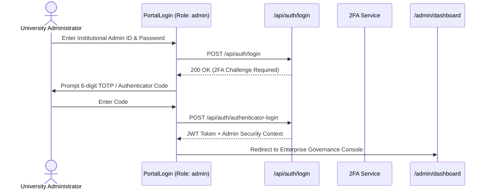

# 🏛️ Enterprise University Admin Transformation Blueprint
## Architectural Specification & Fullstack Implementation Plan

---

## Executive Summary
This document specifies the end-to-end transformation of the **EduERP Admin Portal** from a cluttered prototype into an **Enterprise-Grade University Governance Cockpit**. 

In real-world institutions (e.g. Stanford, MIT, Oxford, Anna University, VTU), the IT Administrator / Chief Information Officer (CIO) does **not** manage library book loans, hostel beds, or daily classroom roll calls. Instead, the Administrator governs **Identity (IAM), System Health, Academic Windows, Security Compliance, and Enterprise Master Data**.

---

## 1. 3-Layer Impact Analysis (Rule 5 Compliance)

| Layer | Existing Prototype State | Target Enterprise State |
| :--- | :--- | :--- |
| **Frontend UI (Login)** | Mixed webcam face scan button, public reset link, confusing developer badges. | Clean, hardened enterprise login with institutional credentials, TOTP Authenticator 2FA, brute-force lock banner. |
| **Frontend UI (Console)** | 17 operational items mixed together (Library, Hostel, Canteen, Attendance, Placement). | 5 dedicated enterprise governance suites: **Overview, IAM, Master Setup, Academic Windows, and Security/Integrations**. |
| **Backend API** | Generic `/dashboard/admin` returning static counts; loose role checks. | Dedicated `/api/admin/system-health`, `/api/admin/iam`, `/api/admin/academic-windows`, and `/api/admin/audit-logs` endpoints. |
| **Database Layer** | Tables exist across domains but lack explicit system config and window state tables. | Clean relational support for `system_settings`, `registration_windows`, and `audit_logs` indexes. |

---

## 2. Phase 1: Clean & Hardened Admin Login Page

### 2.1 File: `src/app/portal/PortalLogin.tsx`
* **Changes to Apply for Role = `admin`:**
  1. **Remove Consumer Face Login:** Suppress `setShowFaceModal(true)` button specifically for the Administrator role. Consumer webcams are never used for root admin access.
  2. **Enforce Enterprise MFA/TOTP:** Support institutional email/username + Password + 6-digit Authenticator code (Google Authenticator / Microsoft Authenticator / YubiKey).
  3. **Security Lockout Telemetry:** Display remaining lockout minutes and contact protocol if brute-force attempts exceed 5 failures.
  4. **Remove Unwanted Clutter:** Eliminate `"✨ Auto-Detect Ready"`, `"Nonce: 15s"`, and developer version strings.



---

## 3. Phase 2: Restructuring the Admin Navigation & Sidebar

### 3.1 Separation of Concerns (Delegation of Operational Tasks)
The following modules will be **removed from the Admin sidebar** and delegated exclusively to their rightful operational roles:
* **Library Management:** Accessible via `/librarian/dashboard` (Librarian role).
* **Hostel Management:** Accessible via `/hostel/dashboard` (Hostel Warden role).
* **Placement Drives:** Accessible via `/placement/dashboard` (Placement Officer role).
* **Classroom Roll Call:** Accessible via `/faculty/dashboard` and `/hod/dashboard`.
* **Cashier Fee Payments:** Accessible via `/accountant/dashboard`.

### 3.2 The 5 Real-World Enterprise Admin Suites

```
┌─────────────────────────────────────────────────────────────┐
│                   EduERP Administrator Console              │
├─────────────────────────────────────────────────────────────┤
│                                                             │
│  📊 SUITE 1: SYSTEM HEALTH & TELEMETRY                      │
│     ├── 1.1 Executive Overview (Active Users, Load)         │
│     └── 1.2 Database & Server Health (Latency, Pool, Uptime)│
│                                                             │
│  🛡️ SUITE 2: IDENTITY & ACCESS MANAGEMENT (IAM)             │
│     ├── 2.1 User Directory (Students, Faculty, Staff)       │
│     ├── 2.2 Role & Permission Delegation (14 Roles)         │
│     ├── 2.3 Account Lockouts & Password Enforcement         │
│     └── 2.4 Active Session Termination                      │
│                                                             │
│  🏛️ SUITE 3: UNIVERSITY MASTER SETUP                        │
│     ├── 3.1 Campuses, Blocks & Room Capacities              │
│     ├── 3.2 Departments & Programs (B.Tech, MBA, Ph.D)      │
│     └── 3.3 Curriculum Frameworks (NEP 2020 / CBCS Scales)  │
│                                                             │
│  📅 SUITE 4: ACADEMIC GOVERNANCE & WINDOWS                  │
│     ├── 4.1 Academic Year & Term Activation (2025–26)       │
│     ├── 4.2 Course Registration Windows (Open / Close)      │
│     └── 4.3 Examination Marks Freezing Deadlines            │
│                                                             │
│  ⚙️ SUITE 5: SECURITY, INTEGRATIONS & DATA HUB              │
│     ├── 5.1 Immutable Forensic Audit Logs                   │
│     ├── 5.2 Bulk Data Hub (Excel/CSV High-Speed Importer)   │
│     ├── 5.3 Communication Gateways (SMTP / SMS / Webhooks)  │
│     └── 5.4 Database Backup & Government Compliance Export  │
│                                                             │
└─────────────────────────────────────────────────────────────┘
```

---

## 4. Phase 3: The Real-World Admin Dashboard Cards & Telemetry

### 4.1 Remove "Toy Prototype" Buttons
* **Delete:** The dummy *"Authorize & Sign Convocation Degrees"* button on lines 688–699 of `src/app/App.tsx` (belongs strictly to the Chancellor/COE).
* **Replace:** Generic student/faculty count cards with **Mission-Critical Institutional Telemetry**:

### 4.2 Target Enterprise Telemetry Cards
1. **Total Managed Identities:** 
   - Breakdown of Active Students, Employed Faculty, and Administrative Staff.
2. **System Health & Uptime:** 
   - Database query latency (e.g., `42ms`), TiDB connection pool state, API gateway status (`99.98% online`).
3. **Academic Registration Status:** 
   - Current open windows (e.g. *"Fall 2026 Course Enrollment: OPEN (Closes in 3 days)"*).
4. **Security & Threat Radar:** 
   - Failed login attempts in the last 24h, locked accounts pending review, active concurrent sessions.

---

## 5. Phase 4: Fullstack Implementation Roadmap

### Wave 1: Admin Login Hardening
* **File:** `src/app/portal/PortalLogin.tsx`
* **Task:** Conditional rendering to hide consumer face scan button when `effectiveRole === 'admin'`, enforce password + TOTP Authenticator flow, and remove distracting badges.

### Wave 2: Sidebar & Navigation Restructure
* **File:** `src/app/App.tsx` (`SIDEBAR_ITEMS`)
* **Task:** Replace the 17 flat items with grouped, role-appropriate enterprise suites (IAM, Master Structure, Academic Windows, Security, Integrations).

### Wave 3: Admin Dashboard Home Overhaul
* **File:** `src/app/App.tsx` (`DashboardHome`)
* **Task:** Replace toy action buttons with real system health, active window controllers, and security summary widgets.

### Wave 4: Automated Integrity Guardrail (Rule 6)
* Run `npm run verify:all` (`scripts/verify_integrity.js` and `vite build`) to guarantee 0 TypeScript errors, 0 broken navigation links, and full relational integrity across all 14 roles.

---

## 6. Explicit User Approval Request (Rule 5 & Rule 7)
Before executing code modifications:
1. Confirm if you approve removing the Face Login button from `/admin/login`.
2. Confirm if you approve delegating Library, Hostel, Placement, and Cashier Fees to their dedicated role portals.
3. Once approved, implementation will proceed systematically in accordance with the 7 workspace rules.
